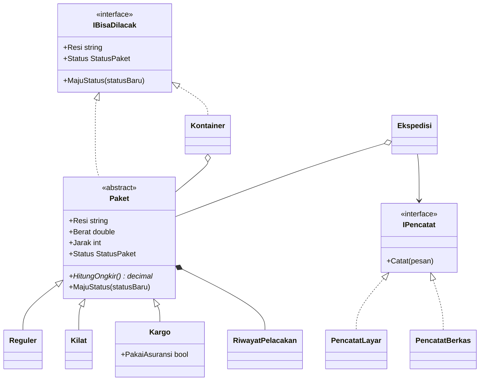

# Proyek ETS PBO

> Baca `SOAL.md` dulu. Ganti semua `TULIS_DI_SINI` di berkas ini, `AI-LOG.md`, dan `PROSES.md`. Berkas yang masih berisi
> `TULIS_DI_SINI` dianggap belum diisi.

## Identitas

- Nama: Novaldi Rayhan Asshiddiqi
- NRP: 5025251188
- Domain (NRP dibagi 6, ambil sisanya): 4 — Ekspedisi Paket

## Domain saya

Saya dapat domain Ekspedisi Paket, jadi ceritanya aplikasi ini dipakai petugas ekspedisi untuk mencatat paket.
Tiap jenis paket tarifnya beda, dan status paket harus urut, DiTerima, DiKirim, Sampai.

## Cara menjalankan

```bash
dotnet build proyek/src
dotnet run --project proyek/src
```

## Diagram kelas



## Status kebutuhan

| ID | Kebutuhan | Status | Catatan |
|---|---|---|---|
| K1 | Enkapsulasi | selesai | Data disembunyikan dan dicek dulu (Paket.cs) |
| K2 | Komposisi dan pewarisan | selesai | Paket punya tiga jenis turunan (Reguler, Kilat, Kargo) |
| K3 | Polimorfisme | selesai | Tiap jenis menghitung ongkirnya sendiri (HitungOngkir) |
| K4 | Abstract class dan interface | selesai | Pencatat dikirim dari luar ( IPencatat, Ekspedisi) |
| K5 | Exception dan life cycle | selesai | Dua error buatan sendiri (UbahStatus, PencatatBerkas) |
| K6 | Aplikasi berjalan | selesai | Demo enam langkah, tidak crash (Program.cs) |
| Khas | Aturan khas domain | selesai | Status hanya maju selangkah (MajuStatus) |
| Bonus | Bonus yang dikerjakan | belum | — |

## Yang belum selesai

Proyek dikerjakan 26 Oktober 2026, jadi commit tidak tersebar di tiga
hari. Jumlah commit lebih dari delapan.

Bonus belum dikerjakan, unit test, JSON, IComparable, pola desain.